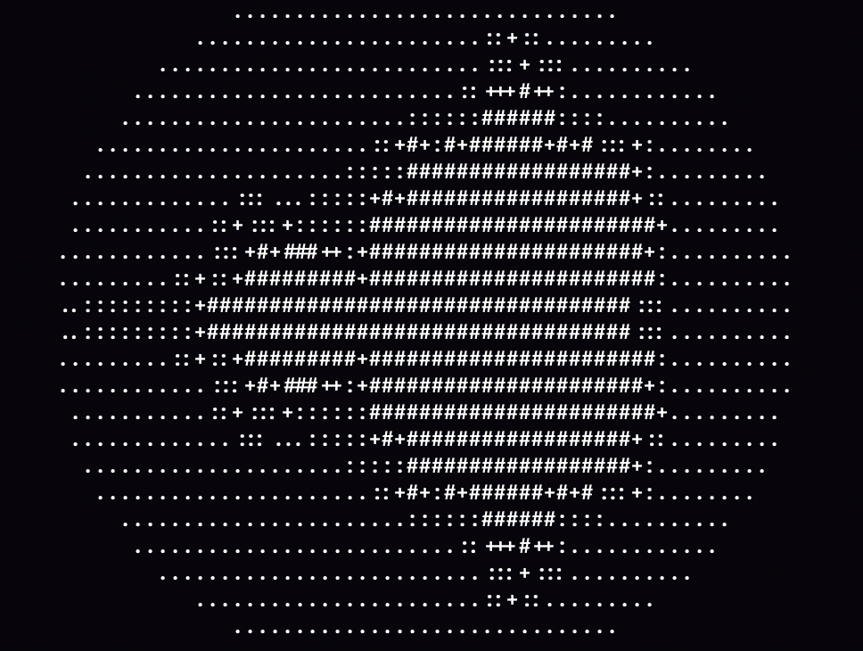

# VM1RS


A stack-based virtual machine that runs instruction sequences and compiles them into .prog binaries

```sh 
./vm1rs test tests/mandelbrot.txt
```



## Commands
| Command  | Description |
|---|---|
| run \<filename\>  | Run .prog file |
| view \<filename\> | View .prog file source code |
| test \<filename\> | Test and run code |
| build \<source\> \<target\> | Build code to .prog file |
| help | Info |
## Error codes
| Error | Description |
|---|---|
| ERR00 | Unknown command |
| ERR01 | Read a file |
| ERR02 | Create a file |
| ERR03 | Write a file |
| ERR04 | Support only .prog files |
| ERR05 | Stack is empty |
| ERR06 | Jump stack is empty |
| ERR07 | Jump limit 1000000 |
| ERR08 | Exit without HALT command |
| ERR09 | Imposible on this galaxy (Div on zero) |
| ERR10 | Empty line |
| ERR11 | Unknown |
## .prog files signature
```
0xFF 0x10 0xFA 0xF8
```
## Stack commands
| Command | Code | Argument | Description |
| --- | --- | --- | --- |
| HALT | 0 | - | Stop the machine |
| PUSH | 1 | n | Push a number or a character code |
| POP | 2 | - | Drop the top item |
| DUP | 3 | - | Duplicate the top item |
| SWAP | 4 | - | Swap the two top items |
| OVER | 5 | - | Copy the second item to the top |
| ROT | 6 | - | Move the third item to the top |
| ADD | 7 | - | Add (wraps on overflow) |
| SUB | 8 | - | Subtract (wraps on overflow) |
| JMP | 9 | addr | Jump to addr |
| JZ | 10 | addr | Pop a; jump to addr if a == 0. Always pops |
| CALL | 11 | addr | Push the return address to the call stack and jump to addr |
| RET | 12 | - | Return to the address popped from the call stack |
| PRINT | 13 | - | Print a as a number |
| LT | 14 | - | Push 1 if a < b, otherwise 0 |
| AND | 15 | - | Bitwise AND |
| EMIT | 16 | - | Print the character with Unicode code c |
| MUL | 17 | - | Multiply (wraps on overflow) |
| DIV | 18 | - | Integer division, rounds toward zero. Error if b == 0 |
| MOD | 19 | - | Remainder, same sign as a. Error if b == 0 |
| READ | 20 | - | Read a line from stdin and push it as a number (0 if not a number) |
| LOAD | 21 | k | Push the value of memory cell k |
| STORE | 22 | k | Pop a into memory cell k |
| LOADI | 23 | - | Indirect load: the cell address is taken from the stack |
| STOREI | 24 | - | Indirect store: mem[addr] = v, the address is on top |
| KEY | 25 | - | Read a line from stdin and push the code of its first character (space if empty) |


## Links
- [Examples](/tests)
